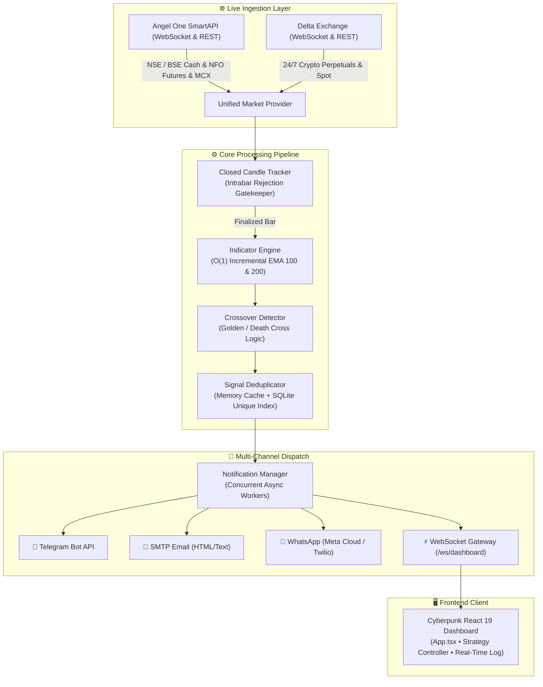

<div align="center">

# ⚡ QUANTORA
### Institutional-Grade Multi-Asset Technical Alert & Quant Engine
**Real-Time Closed-Candle EMA (100 / 200) Cross-Market Surveillance Platform**

[](https://fastapi.tiangolo.com)
[](https://react.dev)
[](https://www.typescriptlang.org)
[](https://www.python.org)
[](https://sqlite.org)
[](https://www.docker.com)
[](https://opensource.org/licenses/MIT)

<p align="center">
  <a href="#-overview">Overview</a> •
  <a href="#-key-features">Key Features</a> •
  <a href="#-architecture">Architecture</a> •
  <a href="#-supported-markets">Markets</a> •
  <a href="#-quant-engine-internals">Quant Internals</a> •
  <a href="#-quick-start">Quick Start</a> •
  <a href="#-api-spec">API & WebSocket</a> •
  <a href="#-disclaimer">Disclaimer</a>
</p>

---

</div>

<br/>

## 💎 Overview

**Quantora** is a high-frequency, resilient, event-driven market surveillance platform engineered for systematic traders and quant desks. It continuously monitors live tick streams across **Indian Cash Equities (NSE/BSE)**, **Equity Futures (NFO)**, **Commodities (MCX Futures)**, and **Cryptocurrency (Delta Exchange 24/7)** to identify golden crosses and death crosses on the institutional **EMA 100 / EMA 200** indicator pair.

Built on an asynchronous micro-kernel, Quantora eliminates intrabar false alarms by computing signals strictly on **confirmed candle closes**, guarantees **deterministic deduplication** across reboots and network blips, and features a **Quant Startup Catch-Up Protocol** that audits and surfaces prevailing trade opportunities when the system boots mid-session.

> [!IMPORTANT]
> ### 🛡️ STRICT ARCHITECTURAL GUARDRAIL: ALERT-ONLY SYSTEM
> Quantora is intentionally engineered as an **alerting and signal generation engine**. It deliberately contains **NO trade routing, auto-execution, or account modification capabilities**.
>
> `MARKET FEEDS → CLOSED CANDLE GATEKEEPER → EMA ENGINE → SIGNAL AUDIT → NOTIFICATION DISPATCH`

<br/>

---

## 🚀 Key Features

<table>
  <tr>
    <td width="50%">
      <h3>🎯 Zero Intrabar False Signals</h3>
      <p>Raw ticks and forming candles are isolated. Moving average state transitions and crossover detections are triggered <b>strictly on finalized, closed candle boundaries</b> (5m, 10m, 15m, 30m, 1h).</p>
    </td>
    <td width="50%">
      <h3>⚡ $O(1)$ Incremental EMA Engine</h3>
      <p>Calculates dual Exponential Moving Averages (EMA 100 fast / EMA 200 slow) in constant time per bar, preceded by historical warm-up routines (250+ bars) ensuring mathematical convergence.</p>
    </td>
  </tr>
  <tr>
    <td width="50%">
      <h3>🔄 Quant Startup Catch-Up Protocol</h3>
      <p>Booting the server mid-trading session? Quantora replays historical warm-up data, determines the <i>exact last crossover</i> for each active stock across your configured timeframes, measures <b>trigger vs current price drift</b>, and dispatches a comprehensive catch-up briefing.</p>
    </td>
    <td width="50%">
      <h3>🔒 Deterministic Deduplication</h3>
      <p>Every signal identity is deterministically hashed with provider, token, interval, bar timestamp, and strategy version. Dual-tier verification (50k in-memory set + SQLite unique index) prevents duplicate alerts across reconnects.</p>
    </td>
  </tr>
  <tr>
    <td width="50%">
      <h3>📡 Multi-Channel Failure Isolation</h3>
      <p>Concurrent push alerts dispatched to <b>Telegram Bot</b>, <b>SMTP Email</b>, and <b>WhatsApp (Meta Cloud API / Twilio)</b>. A rate limit or outage on one channel will never stall or impact delivery on the others.</p>
    </td>
    <td width="50%">
      <h3>💻 Cyberpunk Web Terminal</h3>
      <p>A full-featured dark-theme React 19 + TypeScript dashboard featuring live WebSocket alert feeds, multi-timeframe bulk controllers, stock-level overrides, and dynamic scrip search.</p>
    </td>
  </tr>
</table>

<br/>

---

## 🏛️ Architecture Overview



<br/>

---

## 📊 Supported Markets & Asset Classes

| Asset Class | Market Provider | Exchange | Default Monitored Universe | Dynamic Discovery |
| :--- | :--- | :---: | :--- | :--- |
| **Indian Cash Equities** | Angel One SmartAPI | **NSE / BSE** | Bluechips & high-beta leaders (INDUSINDBK, SBIN, TITAN, VBL, HAL, etc.) | Official JSON Scrip Master (~147k instruments) |
| **Indian Equity Futures** | Angel One SmartAPI | **NFO** | Index & Heavyweight Futures (NIFTY, BANKNIFTY, RELIANCE, TCS, INFY) | Auto-rolls to active near-month expiry |
| **Indian Commodities** | Angel One SmartAPI | **MCX** | Energy & Metal Futures (CRUDEOIL, CRUDEOILM, NATURALGASM) | **Futures-only** (FUTCOM priority; options stripped) |
| **Cryptocurrency** | Delta Exchange | **DELTA** | Major Perpetuals (BTCUSD, ETHUSD, SOLUSD, BNBUSD, AVAXUSD) | REST `/v2/products` discovery |

<br/>

---

## 🔬 Quant Engine Internals

### 1. Incremental EMA Formula
Rather than retaining entire price arrays in memory, Quantora updates the EMA state recursively upon receiving closed bar $t$:

$$\alpha_{\text{fast}} = \frac{2}{100 + 1} \approx 0.01980, \quad \alpha_{\text{slow}} = \frac{2}{200 + 1} \approx 0.00995$$

$$\text{EMA}_{t} = (\text{Close}_{t} \times \alpha) + \Big(\text{EMA}_{t-1} \times (1 - \alpha)\Big)$$

### 2. Strict Crossover Invariants
- **Bullish Golden Cross ($🟢$)**: $\text{EMA100}_{t-1} \le \text{EMA200}_{t-1} \quad \text{AND} \quad \text{EMA100}_{t} > \text{EMA200}_{t}$
- **Bearish Death Cross ($🔴$)**: $\text{EMA100}_{t-1} \ge \text{EMA200}_{t-1} \quad \text{AND} \quad \text{EMA100}_{t} < \text{EMA200}_{t}$

### 3. Startup Catch-Up Protocol
When the server starts during live market hours:
1. Historical native-timeframe candles (minimum 250 bars) are ingested.
2. The indicator engine replays the sequence to warm up mathematical EMA convergence.
3. Quantora inspects each configured stock and time frame:
   - Identifies the timestamp of the **most recent crossover**.
   - Determines if the indicator regime remains **active** (i.e. fast EMA is still above/below slow EMA).
   - Calculates **price drift**: $\Delta P = P_{\text{current}} - P_{\text{trigger}}$ and percentage slippage.
   - Pushes an actionable `[STARTUP CATCH-UP]` alert to all subscribed channels.

<br/>

---

## 🛠️ Directory Structure

```plaintext
quantora/
├── backend/
│   ├── app/
│   │   ├── main.py                     # Application lifecycle, startup catchup & FastAPI factory
│   │   ├── api/
│   │   │   ├── routes.py               # REST API endpoints (universe config, purge, health)
│   │   │   └── websocket.py            # Live WebSocket connection manager
│   │   ├── config/
│   │   │   ├── settings.py             # Pydantic Settings & YAML loader
│   │   │   └── default_config.yaml     # Baseline universe, strategy rules & notifications
│   │   ├── core/
│   │   │   ├── event_bus.py            # Decoupled async pub/sub
│   │   │   ├── market_hours.py         # IST session validator (NSE/MCX vs 24/7 Crypto)
│   │   │   └── logging.py              # Structured logging
│   │   ├── database/
│   │   │   ├── models.py               # SQLAlchemy ORM models (Signals, Deliveries, Metadata)
│   │   │   └── session.py              # Async engine & SQLite WAL config
│   │   ├── indicators/
│   │   │   ├── ema.py                  # O(1) incremental EMA calculator
│   │   │   └── indicator_engine.py     # Multi-instrument, multi-timeframe state coordinator
│   │   ├── market_data/
│   │   │   ├── closed_candle_tracker.py# Intrabar tick accumulator & boundary trigger
│   │   │   ├── instrument_manager.py   # Dynamic discovery & commodity futures filter
│   │   │   └── stream_manager.py       # Warm-up orchestrator & gap recovery
│   │   ├── notifications/
│   │   │   ├── notification_manager.py # Concurrent channel dispatcher with failure isolation
│   │   │   ├── telegram.py             # Telegram Bot API client
│   │   │   ├── email.py                # Asynchronous SMTP client (aiosmtplib)
│   │   │   ├── whatsapp.py             # Meta Cloud API & Twilio adapter
│   │   │   └── formatter.py            # Minimal, Standard, and Detailed alert templates
│   │   ├── providers/
│   │   │   ├── angelone/               # Angel One SmartAPI (auth, websocket, scrip parser)
│   │   │   └── delta/                  # Delta Exchange (REST & WebSocket client)
│   │   └── signals/
│   │       ├── crossover_detector.py   # Exact EMA crossover mathematics
│   │       ├── deduplicator.py         # In-memory + persistent SQLite signal deduplication
│   │       └── signal_engine.py        # Signal creation & registry
│   └── tests/                          # 21 pytest verification tests
├── frontend/
│   ├── src/
│   │   ├── App.tsx                     # Cyberpunk dashboard & multi-timeframe controller
│   │   ├── index.css                   # Cyber styling & animations
│   │   ├── types.ts                    # TypeScript domain interfaces
│   │   └── constants.ts                # Popular equity, futures, & crypto presets
│   └── package.json                    # React 19 + Vite 8 dependencies
├── Dockerfile                          # Optimized multi-stage production container
├── docker-compose.yml                  # Service orchestration
├── requirements.txt                    # Python dependencies
└── .env.example                        # Template environment configuration
```

<br/>

---

## 🚦 Quick Start

### Option A: Local Python & Node Setup

#### 1. Clone & Configure
```bash
git clone https://github.com/Shivam-dev30/Quantora.git
cd Quantora
cp .env.example .env
```
*Edit `.env` with your Angel One API credentials, TOTP secret, and Telegram Bot token.*

#### 2. Install Backend Dependencies
```bash
python -m venv venv
# Windows:
.\venv\Scripts\activate
# Linux/macOS:
source venv/bin/activate

pip install -r requirements.txt
```

#### 3. Build Frontend Dashboard
```bash
cd frontend
npm install
npm run build
cd ..
```

#### 4. Launch the Platform
```bash
python -m backend.app.main
```
Open **`http://localhost:8000`** in your browser.

---

### Option B: Docker Production Deployment

```bash
docker-compose up -d --build
```
Access the dashboard at `http://localhost:8000` with automated container restarts and healthcheck checks.

<br/>

---

## 🧪 Test Suite

Run the full battery of automated tests verifying EMA calculations, intrabar rejection, deduplication integrity, and cross-asset golden datasets:

```bash
python -m pytest backend/tests -v
```

```plaintext
============================== test session starts ==============================
backend/tests/test_alert_configuration.py::test_config_loader PASSED      [  4%]
backend/tests/test_closed_candle.py::test_intrabar_tick_suppression PASSED[  9%]
backend/tests/test_closed_candle.py::test_candle_closure_emission PASSED   [ 14%]
backend/tests/test_crossover.py::test_bullish_golden_cross PASSED         [ 19%]
backend/tests/test_crossover.py::test_bearish_death_cross PASSED          [ 23%]
backend/tests/test_deduplication.py::test_duplicate_rejection PASSED      [ 28%]
backend/tests/test_ema.py::test_incremental_vs_pandas_ewm PASSED          [ 33%]
backend/tests/test_golden_data.py::test_reliance_golden_dataset PASSED    [ 38%]
backend/tests/test_golden_data.py::test_nifty_futures_dataset PASSED      [ 42%]
backend/tests/test_golden_data.py::test_crudeoil_commodity_dataset PASSED [ 47%]
backend/tests/test_golden_data.py::test_btcusd_crypto_dataset PASSED       [ 52%]
...
============================== 21 passed in 1.98s ===============================
```

<br/>

---

## 🔌 API & WebSocket Reference

| Method | Endpoint | Description |
| :---: | :--- | :--- |
| `GET` | `/health` | Connectivity heartbeat for providers, database, and event bus. |
| `GET` | `/status` | Real-time monitoring metrics, active provider counts, and health. |
| `GET` | `/api/active-alerts` | Full dashboard snapshot (monitored items, recent alerts, config). |
| `POST`| `/api/alerts/configure` | Bulk update master timeframes or per-instrument timeframe maps. |
| `DELETE`| `/api/alerts/instrument` | Purge an instrument from monitoring across YAML and live streams. |
| `POST`| `/api/engine/toggle` | Soft start/stop signal detection engine. |
| `POST`| `/api/test-alert` | Dispatch an end-to-end verification alert across all active channels. |
| `WS`  | `/ws/dashboard` | Bidirectional real-time stream broadcasting `NEW_ALERT` & status pulses. |

<br/>

---

## ⚠️ Disclaimer

**Quantora is an informational software tool designed for technical market research and educational alerting purposes.** It does not constitute financial, investment, or trading advice. Trading in cash equities, derivatives (futures & options), commodities, and cryptocurrencies involves substantial risk of capital loss. Always perform independent due diligence or consult an accredited financial advisor before committing capital to financial markets.

<br/>

---

<div align="center">
  <sub>Engineered by <a href="https://github.com/Shivam-dev30">Shivam Dev</a> • Built with FastAPI, React 19, and TypeScript</sub>
</div>
